<p align="center">
  
</p>

<h1 align="center">FilesToMB</h1>

<p align="center">
  <b>Get the music you already have into <a href="https://musicbrainz.org">MusicBrainz</a>, and keep your library tidy while you do it.</b><br>
  A self-hosted web app that matches your albums, pre-fills the MusicBrainz edit forms, and hands the result to Picard, Lidarr and your genre tagger.
</p>

<p align="center">
  <a href="https://hub.docker.com/r/wb20244/filestomb"></a>
  <a href="LICENSE"></a>
  
</p>

<p align="center">
  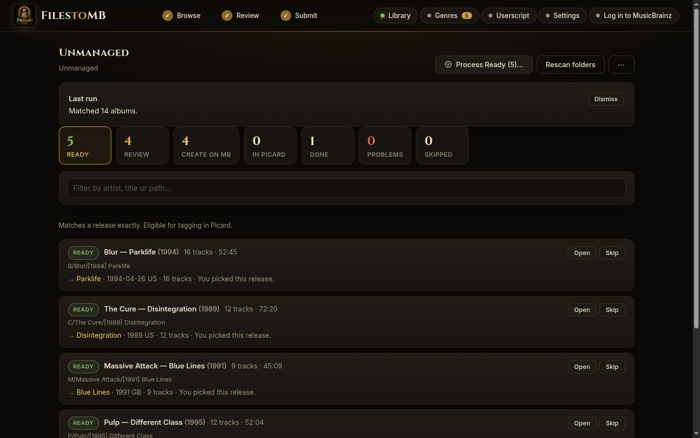
</p>

## What it does

You have albums with carefully checked tags. MusicBrainz doesn't know about some of them yet, or knows them under several near-identical editions. FilesToMB closes that gap:

1. **Matches** every album against MusicBrainz, by artist, release group and release, using your tags *and* the track lengths.
2. **Pre-fills** the "add artist / release group / release" forms for anything missing, in the right order, so you only review and click Submit.
3. **Hands over** the finished album: tags it with the exact release IDs, sends it to Picard, adds it to Lidarr and gets its genre set.

Point it at one album, or at a whole folder of thousands.

## Highlights

- **Whole-library batch mode.** Scan `Unmanaged/` and every album, at any depth, is sorted into *Ready*, *Review* or *Create on MusicBrainz*.
- **Strict, explainable matching.** "Ready" means every file matches a track on one specific release, with agreeing titles, lengths and artist. Anything less goes to a human.
- **Seeded forms, in dependency order.** Label and artist, then release group, then release. Several artists in one credit? Split on any separator you like.
- **Cover art from everywhere.** Local files, upload, drag and drop, paste, the Cover Art Archive and fanart.tv. A userscript attaches it for you on MusicBrainz's upload page.
- **Picard, Lidarr, Genre Enforcer.** Optional hand-offs that turn "it's on MusicBrainz" into "it's in my library, tagged and organised".
- **Careful with your files.** Reads are read-only, every write is gated and verified, nothing is ever deleted, and there's an audit log. See [Safety](#safety).

## Screenshots

### Match, review, fix

Every entity is matched on its own, so "artist exists, release doesn't" never creates a duplicate. Pick a candidate, paste an ID, or mark it as new.

<p align="center">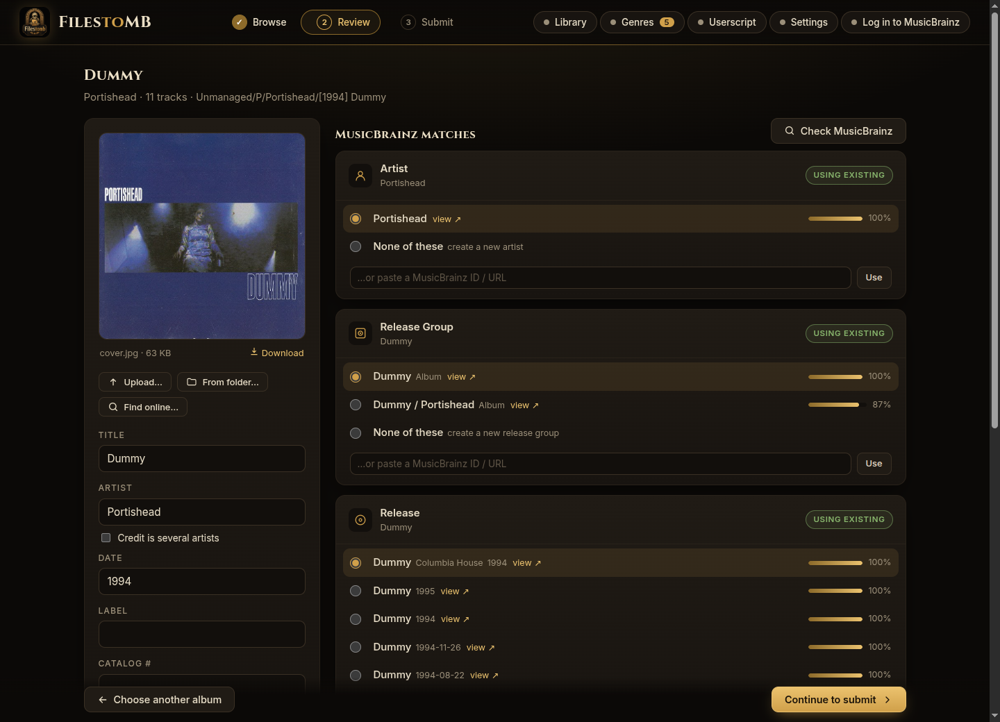</p>

Missed it? Hit **Search…** on any entity, type what you know, and pick from live MusicBrainz results, or create it if there are none.

<p align="center">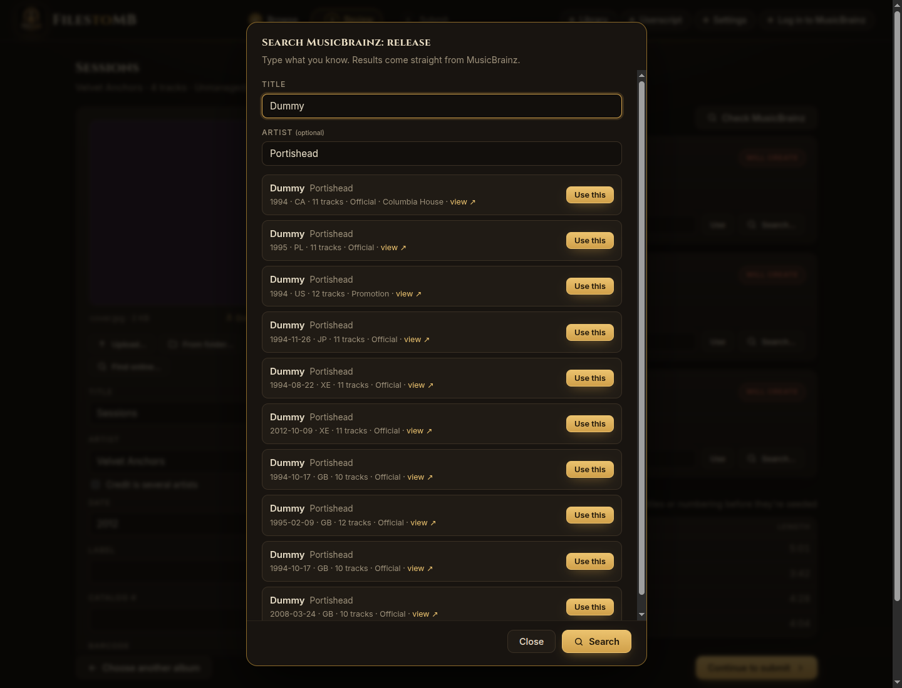</p>

### Several artists in one credit

*Morrissey & Johnny Marr* is two artists, not one. Tick the box, type the separator, and each artist is matched and created separately, then joined back into a single credit on the release.

<p align="center">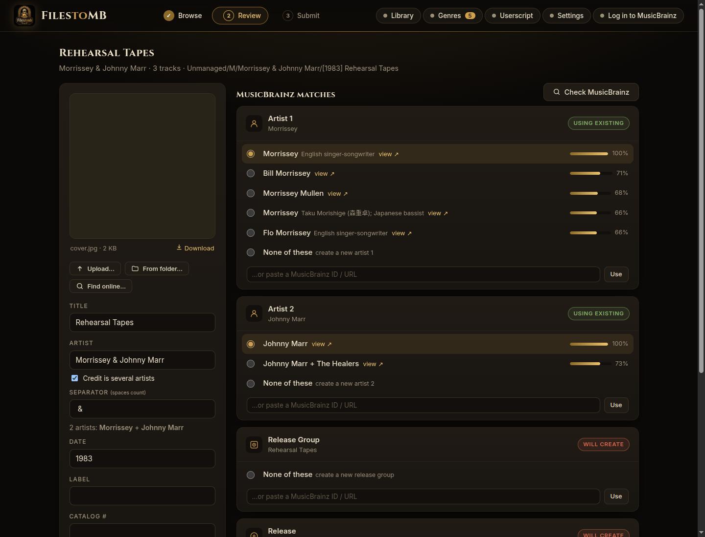</p>

### Submit, then hand over

MusicBrainz has no API for creating artists or releases, so each step opens the real edit form pre-filled. As IDs come back, the same screen carries on: tag and send to Picard, add to Lidarr by the exact release, set the artist's genre.

<p align="center">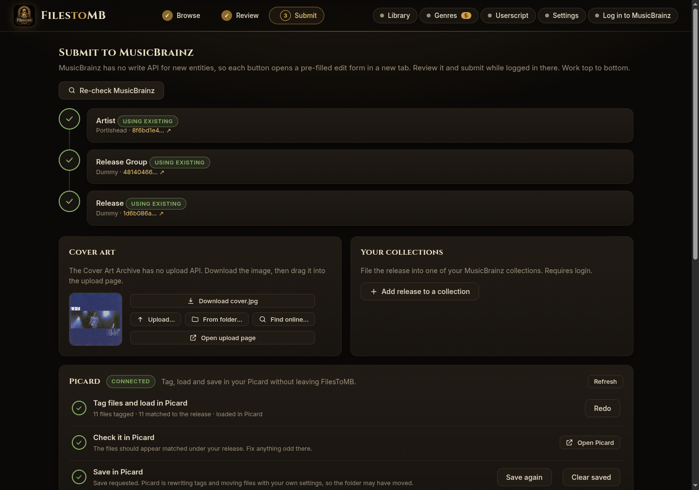</p>
<p align="center">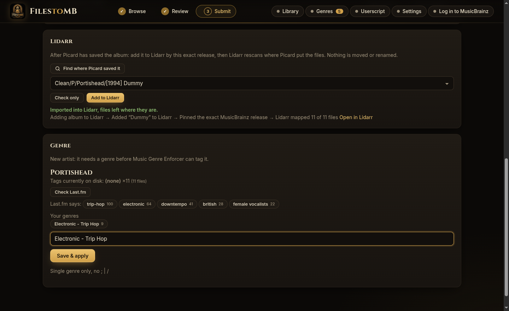</p>

### Work through a whole library

Matching never touches your files. Review rows list the candidates and say *why* each one is or isn't an exact match; Create rows show the closest thing on MusicBrainz so you don't make a duplicate.

<p align="center">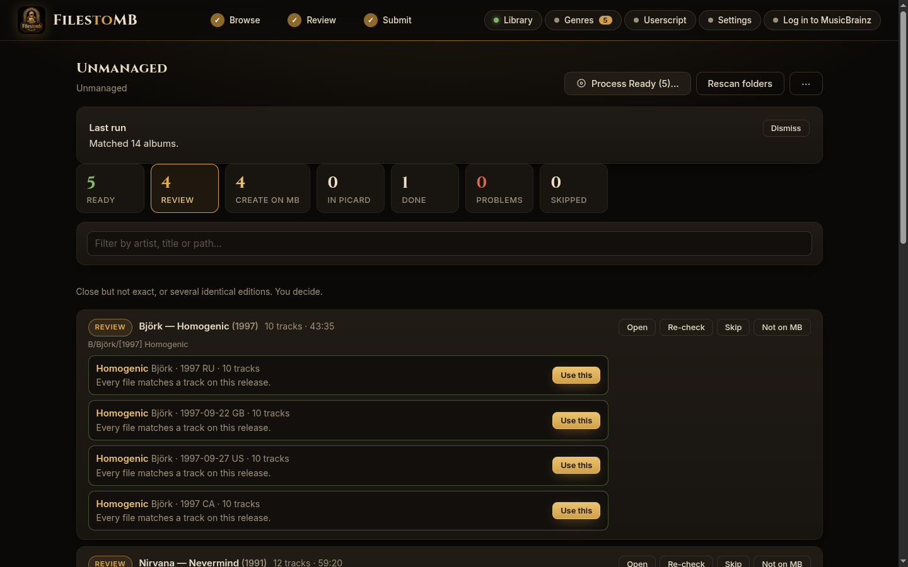</p>

Ready albums are processed one at a time behind an explicit, gated dialog. Start with a trial run of one.

<p align="center">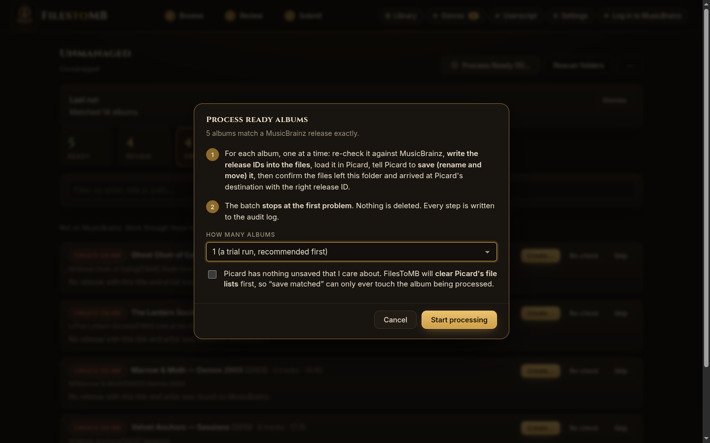</p>

### Cover art

<p align="center">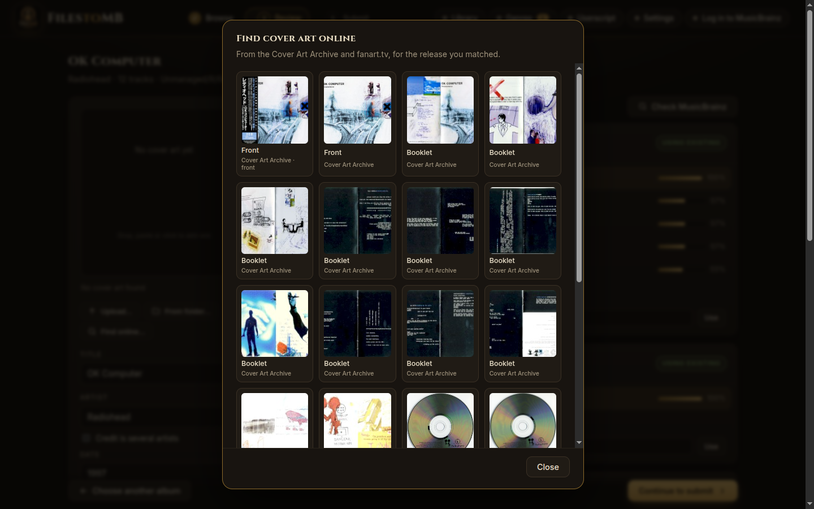</p>

<details>
<summary>More screenshots</summary>

<p align="center">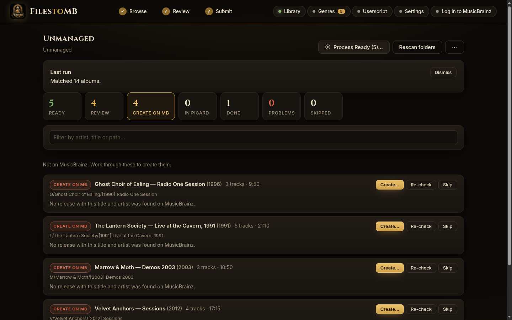</p>
<p align="center">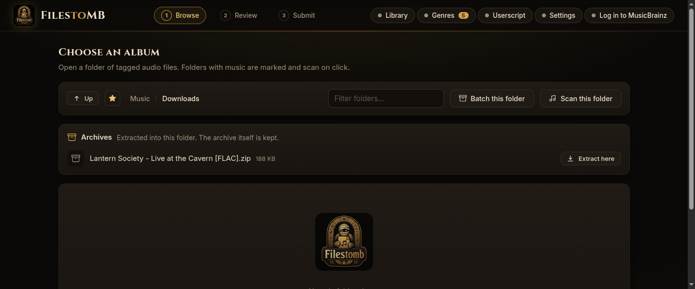</p>
<p align="center">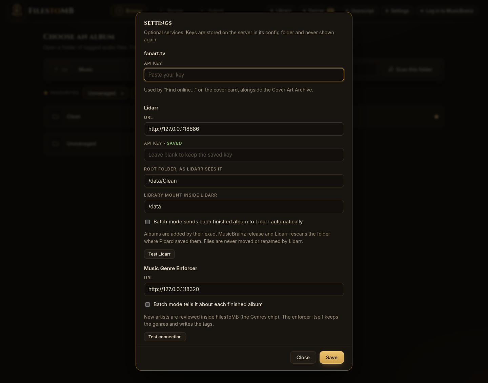</p>

</details>

## Quick start

You need Docker and a folder of tagged music. That's it.

```bash
mkdir filestomb && cd filestomb
curl -O https://raw.githubusercontent.com/WB2024/FilesToMB/main/compose.yaml
curl -o .env https://raw.githubusercontent.com/WB2024/FilesToMB/main/.env.example
```

1. Edit **`.env`** and set `MB_CONTACT` to your email. MusicBrainz requires every client to identify itself; there is no API key.
2. Edit **`compose.yaml`** and point the volume at your music (`/path/to/your/music:/music`).
3. Start it:

```bash
mkdir config && docker compose up -d      # then open http://localhost:8097
```

Run as your own user (`user: "1000:1000"` in the compose file; change it to match the owner of your music and `./config`).

### Settings you might want

| Variable | What for |
|---|---|
| `MB_CONTACT` | **Required.** Your email, sent in the User-Agent MusicBrainz asks for. |
| `PUBLIC_URL` | The address you browse to. Used by the downloadable userscript. |
| `MB_OAUTH_CLIENT_ID` / `_SECRET` | Optional MusicBrainz login (for adding releases to your collections). Register an *Installed application* and leave its redirect URI as `urn:ietf:wg:oauth:2.0:oob`. |
| `FANART_API_KEY` | Optional. Adds fanart.tv to the cover art search. |

Everything optional can also be entered in the app under **Settings**. The full list is in [`.env.example`](.env.example).

## Optional integrations

Each one is off until you configure it, and the app works fine without any of them.

| | What it gives you |
|---|---|
| **[MusicBrainz Picard](https://picard.musicbrainz.org)** | One click writes the release IDs into your files and loads them in Picard, which then renames and moves them with *your* settings. FilesToMB never reimplements Picard's naming. |
| **[Lidarr](https://lidarr.audio)** | Adds the album by its exact MusicBrainz release, pins that edition, and has Lidarr rescan the folder Picard saved to. Files are never moved or renamed by Lidarr. |
| **[Music Genre Enforcer](https://github.com/WB2024/Artist-Genre-Metadata-Enforcer)** | New artists show up in a *Genres* queue inside FilesToMB, with Last.fm suggestions. The enforcer keeps the genres and writes the tags; FilesToMB only calls its API. |
| **ReplayGain ([rsgain](https://github.com/complexlogic/rsgain))** | Runs the same scan as Picard's *ReplayGain 2.0* plugin on the files Picard saved, shows the numbers, then writes the tags. Options are remembered. |
| **fanart.tv** | A second source for cover art next to the Cover Art Archive. |
| **Userscript** | Tampermonkey/Violentmonkey script served by your own instance: attaches cover art on MusicBrainz's upload page and sends newly created IDs back to the app. It never submits an edit. |

<details>
<summary><b>Picard setup</b></summary>

FilesToMB talks to Picard through its remote-command pipe, so the two containers must share the folder it appears in:

```yaml
# picard container                          # filestomb container
- /opt/picard/run:/run/user/<picard-uid>    - /opt/picard/run:/picard-run
```

(For the `aandree5/picard-web` image the folder is `/run/user/gwb`.) Then set in `.env`:

```env
PICARD_PIPE_DIR=/picard-run
PICARD_URL=http://picard.local:5800
PICARD_DEST_ROOT=/music/Clean     # where Picard saves, as seen by FilesToMB
```

Picard must not be set to ignore MBIDs when loading files (the default). `PICARD_DEST_ROOT` lets batch mode *verify* that files really arrived with the right release ID, so set it.
</details>

<details>
<summary><b>ReplayGain setup</b></summary>

Download [rsgain](https://github.com/complexlogic/rsgain/releases) (or reuse the copy Picard's plugin points at), mount its folder read-only, and tell FilesToMB where the binary is:

```yaml
- /path/to/rsgain-folder:/rsgain:ro
```

```env
RSGAIN_PATH=/rsgain/rsgain
```

On the Submit screen, after Picard has saved the album, the **ReplayGain** card finds the saved folder, offers the plugin's options (album gain, true peak, reference tag, target loudness, clipping protection, max peak, Opus mode) and either scans only or writes the tags. Run it before adding to Lidarr. Only files tagged with the release are touched.
</details>

<details>
<summary><b>Lidarr setup</b></summary>

Give FilesToMB the Lidarr URL and API key, the root folder *as Lidarr sees it*, and where Lidarr mounts your library:

```env
LIDARR_URL=http://lidarr.local:8686
LIDARR_API_KEY=...
LIDARR_ROOT_FOLDER=/data/Clean
LIDARR_LIBRARY_PATH=/data      # your library, inside Lidarr's container
```

Use **Check only** on the Submit screen first: it's a dry run that changes nothing. Lidarr uses its own metadata server, so very new or obscure releases may not be known to it yet; FilesToMB reports that rather than guessing.
</details>

## Safety

This tool can write to a music library, so it is deliberately cautious:

- **Reading is read-only.** Discovering and matching albums never writes anything.
- **Only exact matches are processed**, one album at a time, and each is re-verified against MusicBrainz and the folder's contents immediately before anything is touched.
- **A required confirmation** gates every batch run, and Picard's file lists are cleared first so its *save* can only ever touch the album being processed.
- **Verified, not assumed.** After saving, the source folder must be empty of audio and the files must turn up at Picard's destination carrying the right release ID.
- **The batch stops at the first anomaly.** Nothing is deleted. Every step is written to `batch-audit.log` in `/config`.
- **Archives** extract into a temporary folder, with zip-slip and symlink checks and no overwriting.
- Want it truly read-only? Mount your music with `:ro`. The write features switch themselves off.

## How MusicBrainz creation works

MusicBrainz doesn't offer a public write API for new artists, labels, release groups or releases. They're created through the website's own forms, by a logged-in person. FilesToMB uses MusicBrainz's documented [seeding mechanism](https://musicbrainz.org/doc/Development/Seeding) to pre-fill those forms, and every field name was checked against MusicBrainz's server source rather than guessed. The Cover Art Archive has no upload API either, so FilesToMB finds the right image and the userscript drops it into the real upload page for you.

You stay in control: nothing is submitted to MusicBrainz except by you, in your browser.

## Without Docker

```bash
git clone https://github.com/WB2024/FilesToMB.git && cd FilesToMB
pip install -e ".[web]"
cp .env.example .env              # set MB_CONTACT
MUSIC_ROOT=/path/to/music filestomb-web
```

There is also a keyboard-driven terminal UI for single albums: `pip install -e .` then `filestomb /path/to/album`.

## Development

```bash
python3 -m venv .venv && source .venv/bin/activate
pip install -e ".[dev]"
pytest                            # needs ffmpeg
```

The tests generate real (silent) audio with `ffmpeg`, mock MusicBrainz, Lidarr and the genre enforcer over HTTP, and drive a fake Picard through a real named pipe.

## Contributing

Issues and pull requests are welcome, especially bug reports with the album that confused the matcher.

## Licence

MIT. See [LICENSE](LICENSE).

<sub>Album covers in the screenshots are served by the Cover Art Archive and belong to their respective owners. The demo library uses silent audio.</sub>
